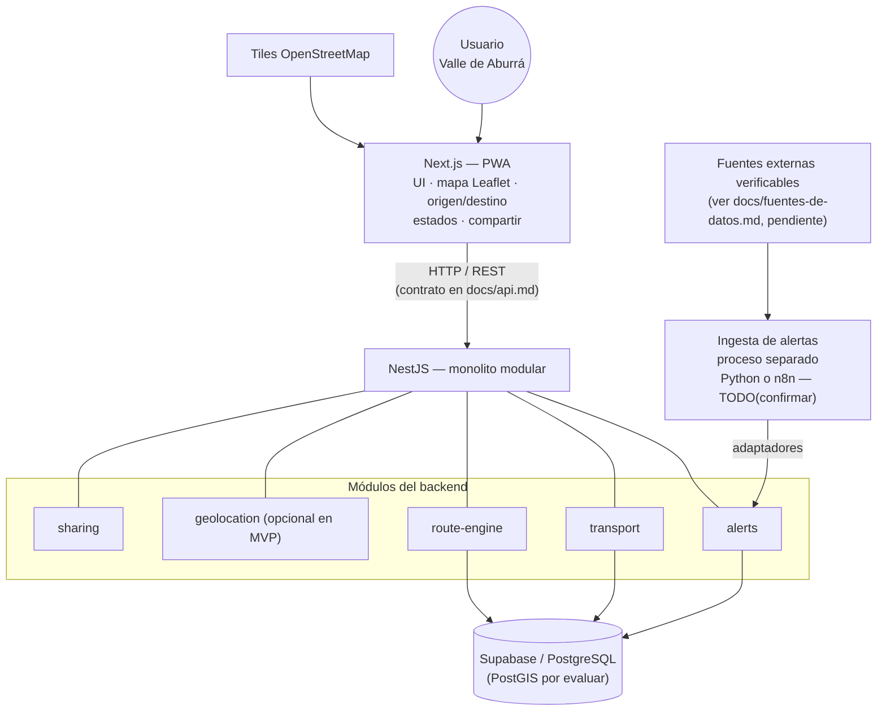
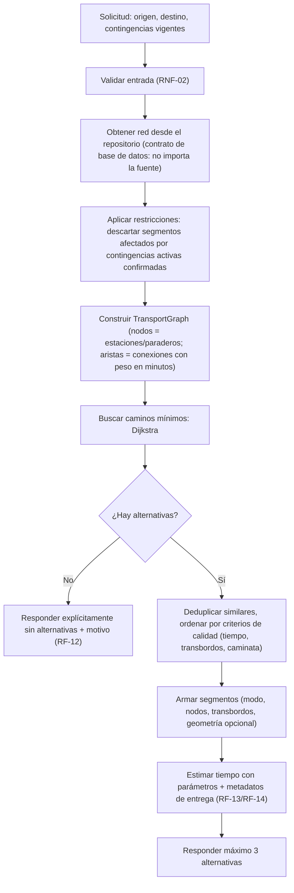
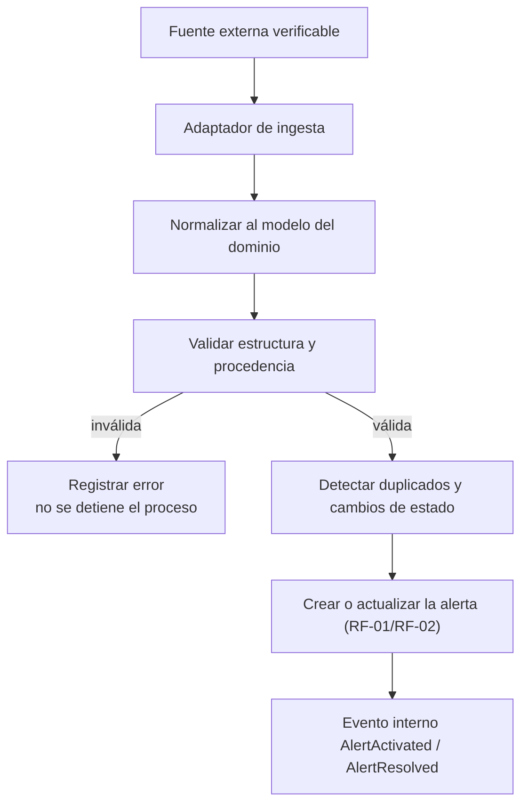

# Arquitectura — MetroAlerta

| Campo | Valor |
|---|---|
| Estado | creado |
| Fecha | 2026-11-05 |
| Fuentes | `AGENTS.md` (§5, §7, §9 — marco) + conversación "Plan de MetroAlerta" (ChatGPT, 2026-11-03, <https://chatgpt.com/share/6aea752c-6ae0-83e9-8e29-6135665fc569>) |
| Alcance | Detalla los componentes, el backend modular y sus límites. Las responsabilidades por componente (frontend/backend/BD/ingesta) se definen en `AGENTS.md` §5; aquí se concretan en módulos y capas, no se duplican. |

**Advertencias de honestidad:**
- La arquitectura descrita aquí es la **propuesta de referencia** derivada de la conversación, alineada con los límites de `AGENTS.md`. Las decisiones formales viven en `docs/adr/`: ADR-001, ADR-005 y ADR-006 aceptados; ADR-002, ADR-003 y ADR-004 propuestos. Ver §10.
- **El código manda:** al 2026-11-05 el backend es el esqueleto NestJS por defecto (`backend/src/main.ts` + `backend/src/app.module.ts`, sin módulos). Lo descrito abajo se adopta de forma incremental conforme se implemente; lo que se marca "ya en el repo" refleja lo verificado.

---

## 1. Visión general

Estilo adoptado (ADR-001): **monolito modular + Clean Architecture + DDD ligero**.

- **Un solo backend desplegable** (NestJS) dividido en módulos con responsabilidades y límites claros.
- Dentro de cada módulo, separación de capas para que las reglas de negocio no dependan de proveedores concretos (Supabase, n8n, tiles, fuentes externas).
- El diseño de dominio se organiza alrededor de los conceptos del negocio (línea, estación, paradero, alerta, contingencia, ruta alternativa, transbordo — glosario en `AGENTS.md` §6 y en `docs/dominio.md`).
- **No microservicios.** El servicio de ingesta es un proceso separado, no una arquitectura distribuida (regla de `AGENTS.md` §5).

La motivación arquitectónica no es académica: el cálculo de rutas es el corazón del problema (las estaciones y paraderos son nodos, las conexiones son aristas con costo en tiempo, y una contingencia deshabilita aristas). Ese motor debe poder evolucionar —cambiar de algoritmo, de almacenamiento o de fuente de datos— sin arrastrar controladores HTTP, consultas a la base de datos ni la UI.

## 2. Componentes del sistema

Componentes y responsabilidades por componente: ver `AGENTS.md` §5 (tabla autoritativa). Los detalles por módulo están en §4 y §5.



Reglas del diagrama:
- El frontend **no** consulta las tablas de Supabase ni calcula rutas: solo consume la API del backend.
- La ingesta **no** escribe la lógica del dominio: normaliza y valida lo que llega de una fuente, y entrega datos ya depurados.
- Una falla en las fuentes externas o en los tiles no detiene la aplicación: se degrada e informa (`AGENTS.md` §5/§7).

## 3. Estructura del repositorio

Situación real del repositorio (2026-11-06): `backend/` existe (NestJS + Vitest + oxlint + pnpm, esqueleto); el frontend aún no existe. ADR-006 acepta un monorepo con destino `apps/api`, `apps/web` y `packages/contracts`; la migración es incremental y `backend/` se mantiene hasta el PR dedicado.

Estructura interna propuesta para el backend (se incorpora módulo por módulo según se necesite; no crear 40 carpetas vacías):

```text
backend/src/
├── main.ts
├── app.module.ts
│
├── modules/
│   ├── alerts/
│   │   ├── domain/            # entidades e interfaces del dominio
│   │   ├── application/       # casos de uso + DTOs
│   │   ├── infrastructure/    # repositorios (Supabase) + fuentes externas
│   │   ├── presentation/      # controladores HTTP
│   │   └── alerts.module.ts
│   ├── transport/             # red: líneas, estaciones, paraderos, rutas, conexiones
│   ├── route-engine/          # grafo, algoritmos, alternativas, estimaciones
│   ├── geolocation/           # coordenadas, validación, cercanías (opcional)
│   ├── sharing/               # construcción del mensaje para compartir
│   └── (users/ — no crear hasta que exista una necesidad real)
│
├── shared/                    # filtros, excepciones, utilidades, tipos comunes
└── config/                    # configuración y parámetros
```

ADR-006 define un monorepo con destino `apps/api`, `apps/web` y `packages/contracts`; los contratos compartidos entre frontend y backend (tipos de respuesta, DTOs de la API) irían en `packages/contracts`. Regla: solo comparten **interfaces de comunicación**; nunca entidades de dominio ni implementaciones internas. El detalle de los contratos va en `docs/api.md` y el del modelo de datos en `docs/modelo-de-datos.md`.

## 4. Módulos del backend

| Módulo | Responsable de | No debe | Casos de uso iniciales |
|---|---|---|---|
| `alerts` | Registrar, actualizar y consultar alertas y contingencias; estados (activa / resuelta / vigencia indeterminada); identificar segmentos afectados; recibir información de fuentes externas vía adaptadores. Para el MVP la ingesta automática es opcional: el registro manual/simulado es válido. | Interpretar cualquier publicación como contingencia confirmada (verificación obligatoria). | `CreateAlert`, `GetActiveAlerts`, `UpdateAlert`, `ResolveAlert`, `ImportExternalAlert` |
| `transport` | Red de transporte: líneas, estaciones, paraderos, rutas, conexiones, tiempos estimados, geometrías; importación de datos (GTFS/ArcGIS) cuando haya fuentes validadas. | Inventar estaciones, paraderos o tiempos que no provengan de datos con origen explícito. | `GetTransportNetwork`, `GetNearbyStops`, `ImportTransportData`, `GetTransportLine` |
| `route-engine` | Construir el grafo, calcular alternativas (≤3, sin segmentos afectados) y estimar tiempos con parámetros configurables. | Dibujar mapas, gestionar alertas, consultar la UI o decidir qué es una contingencia. | `CalculateAlternativeRoutes`, `BuildTransportGraph`, `FindShortestPath`, `FindAlternativePaths`, `CalculateJourneyDuration` |
| `geolocation` | Validar coordenadas, calcular distancias, encontrar nodos cercanos. En el MVP puede integrarse dentro de `transport`/`route-engine` si no se justifica un módulo propio. | Obtener ubicación sin permiso explícito o persistirla sin decisión documentada. | `ValidateCoordinates`, `FindNearbyStops` |
| `sharing` | Armar el mensaje compartible (origen, destino, medios, estaciones/paraderos, tiempo estimado marcado como aproximado, contingencia relacionada). | Enviar el mensaje por su cuenta o llamar a la API oficial de WhatsApp: el envío ocurre en el dispositivo del usuario (CA-02 resuelto: `wa.me` + Web Share; ver `docs/api.md`). | `BuildShareMessage` |
| `shared` (carpeta, no módulo) | Filtros de excepción, utilidades, tipos comunes. | Contener reglas de negocio. | — |

Nota de idioma: los nombres de módulos/casos de uso se escriben en inglés por congruencia con la conversación; el idioma de identificadores en el código es TODO(confirmar) en `AGENTS.md` §13.

## 5. Capas (Clean Architecture) y reglas de dependencia

| Capa | Contiene | Depende de |
|---|---|---|
| `domain` | Entidades (Alert, TransportNode, TransportEdge, TransportGraph, AlternativeRoute, RouteSegment…), reglas de negocio e **interfaces** (p. ej. `TransportGraphRepository`). | Solo del dominio. Nunca de frameworks, BD ni proveedores. |
| `application` | Casos de uso que coordinan el dominio (p. ej. `CalculateAlternativeRoutes`) y DTOs. | `domain` (interfaces), nunca implementaciones. |
| `infrastructure` | Implementaciones concretas: repositorios (Supabase), adaptadores de fuentes externas, drivers. | `application`/`domain` (implementa sus interfaces). |
| `presentation` | Controladores HTTP (routes). Solo reciben solicitudes y dan formato a la respuesta. | `application`. |

Regla transversal: **las dependencias apuntan hacia adentro** (presentation → application → domain). Puntos concretos que derivan de esta regla:

- `TransportGraphRepository` es una **interfaz en `domain`**; `SupabaseTransportGraphRepository` es una **implementación en `infrastructure`**. También existirá una implementación con datos simulados para desarrollo y pruebas.
- El dominio no conoce Supabase, n8n, Leaflet ni ninguna fuente concreta (`AGENTS.md` §5).
- La lógica de negocio nunca vive en un controlador (`AGENTS.md` §5).

## 6. Comunicación entre módulos

- **Inyección de dependencias (DI):** para dependencias directas que necesitan respuesta inmediata (el motor consume los contratos de `transport`, no sus tablas ni repositorios internos).
- **Interfaces/contratos:** desacoplan implementaciones de infraestructura (ver §5).
- **Eventos internos:** para notificar cambios que pueden procesarse de forma independiente (p. ej. `AlertActivated` → el motor invalida/adapta la información de segmentos afectados).
- **No** se introducen colas ni brokers (RabbitMQ, Kafka) sin justificación técnica concreta (`AGENTS.md` §5). El MVP no los necesita.

## 7. Route Engine (detalle)

Es el módulo crítico. Pipeline de un cálculo:



Estructura interna propuesta:

```text
route-engine/
├── domain/
│   ├── entities/       # TransportGraph, TransportNode, TransportEdge, RouteSegment, AlternativeRoute
│   ├── algorithms/     # Dijkstra (primero), AlternativePaths (después), A* (solo si la red lo exige)
│   └── interfaces/     # TransportGraphRepository
├── application/
│   └── use-cases/      # CalculateAlternativeRoutes
├── infrastructure/
│   └── repositories/   # SupabaseTransportGraphRepository, SimulatedTransportGraphRepository
├── presentation/
│   └── routes.controller.ts
└── route-engine.module.ts
```

Reglas del motor (derivadas de `AGENTS.md` §6 y de los RF):
1. **Excluye** las aristas afectadas por contingencias activas confirmadas: ninguna alternativa puede atravesarlas (RF-10 y RNF-03 de `requerimientos.md`). La exclusión se levanta cuando la contingencia queda como resuelta (HU-03).
2. Máximo 3 alternativas; si no las hay, respuesta explícita (RF-12).
3. El tiempo se calcula con parámetros nombrados y configurables (`config/` o variables de entorno), nunca constantes dispersas:

| Parámetro | Para | Origen del valor |
|---|---|---|
| velocidad de caminata | segmentos a pie | Fuente validada; provisional = estimado |
| velocidad promedio de bus | segmentos de bus | Fuente validada; provisional = estimado |
| velocidad promedio del Metro | segmentos de Metro | Fuente validada; provisional = estimado |
| tiempo de espera medio | espera en paradero/estación | Fuente validada; provisional = estimado |
| tiempo de transbordo | cambio de servicio | Fuente validada; provisional = estimado |

   Fórmula: `T_total = T_caminata + T_espera + T_transporte + T_transbordos`.
4. **Metadatos obligatorios** de cada estimación: método de cálculo (`SCHEDULED`=horario oficial, `ESTIMATED`=modelo con parámetros), fecha de última actualización de los datos y nivel de confianza (`HIGH`/`MEDIUM`/`LOW`) derivado de reglas documentadas (nunca asignado a juicio). Esto materializa RF-14/RNF-04/RNF-11.
5. Las alternativas guardan la fuente y la frescura de los datos que las produjeron.

Principio de progresión de algoritmos: implementar Dijkstra y validar con una red controlada de 10–20 nodos **antes** de conectar datos reales; recién después evaluar K-caminos (Yen) para las alternativas, y A* si el tamaño de la red lo justifica. Detalle del plan de estudio en `docs/tareas-de-investigacion.md` (Asignatura 3).

## 8. Ingesta de alertas



- La decisión Python vs n8n es abierta (`AGENTS.md` §4, ADR en §10). El proceso de ingesta es **separable**: cambiar una fuente no obliga a tocar el dominio ni la UI.
- El scraping de X/Twitter **no** es una dependencia del MVP: la primera etapa es registro manual/simulado, luego se investigan fuentes oficiales (ver `docs/tareas-de-investigacion.md`, INV-07).
- Una fuente que deja de responder se registra y se informa; no tumba la app (RNF-09).

## 9. Seguridad

Reglas completas en `AGENTS.md` §9 (fuente de verdad). Resumen de su reflejo arquitectónico:

- Validación en los límites (controles de entrada + validación de DTOs).
- `service role key` de Supabase solo en el backend; el frontend usa credenciales de lectura restringidas o consumo exclusivo vía API.
- Permisos de la base de datos explícitos (RLS en cualquier tabla expuesta).
- Secretos en variables de entorno; `.env.example` sin valores.

## 10. Decisiones arquitectónicas (ADR)

Las decisiones se formalizan en `docs/adr/` (índice en `docs/adr/README.md`). La correspondencia de IDs y decisiones abiertas está en `docs/trazabilidad.md`:

| ADR | Decisión | Estado | Archivo |
|---|---|---|---|
| ADR-001 | Estilo arquitectónico global: monolito modular + Clean Architecture + DDD ligero | aceptado | [`0001-estilo-arquitectonico.md`](adr/0001-estilo-arquitectonico.md) |
| ADR-002 | Tecnología de ingesta: Python vs. n8n | propuesto | [`0002-tecnologia-ingesta.md`](adr/0002-tecnologia-ingesta.md) |
| ADR-003 | Alojamiento del backend y de la ingesta | propuesto | [`0003-alojamiento.md`](adr/0003-alojamiento.md) |
| ADR-004 | Proveedor de tiles para producción | propuesto | [`0004-tiles-produccion.md`](adr/0004-tiles-produccion.md) |
| ADR-005 | Modelo de datos: PostGIS sí, pgRouting no; granularidad por conexión | aceptado | [`0005-modelo-datos-postgis.md`](adr/0005-modelo-datos-postgis.md) |
| ADR-006 | Estructura del repositorio: monorepo con migración incremental | aceptado | [`0006-estructura-repositorio.md`](adr/0006-estructura-repositorio.md) |

## 11. Lo que no se introduce (alineado con `AGENTS.md`)

- Microservicios, colas, brokers o arquitectura orientada a eventos externa.
- Módulo `users` (no hay autenticación de pasajeros en el MVP; la conversación la pospone explícitamente).
- IA predictiva, tráfico en tiempo real, GPS de buses, apps nativas, integraciones con transporte privado (exclusiones de `AGENTS.md` §2).
- Patrones de diseño "por gusto": cada patrón (Repository, Adapter, Strategy…) entra cuando exista el problema concreto que resuelve.

## 12. Cuándo actualizar este documento

- Al crear, mover o renombrar un módulo del backend.
- Al cambiar un límite entre capas o la comunicación entre módulos.
- Al ratificar o cambiar una decisión de §10 (el cambio se registra primero en el ADR correspondiente).
