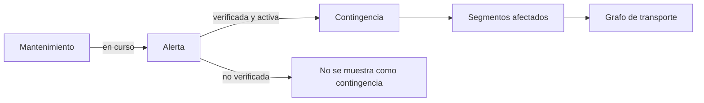

# Dominio — MetroAlert

| Campo | Valor |
|---|---|
| Estado | creado |
| Fecha | 2026-11-06 |
| Fuentes | `AGENTS.md` §6, `docs/requerimientos.md`, `docs/arquitectura.md`, `docs/adr/0001-estilo-arquitectonico.md`, `docs/adr/0005-modelo-datos-postgis.md` |
| Propósito | Fuente única del lenguaje, los estados, las entidades y las reglas de negocio. |
| Autoridad | Si este documento contradice `AGENTS.md`, manda `AGENTS.md`; si contradice el código, manda el código y se señala la diferencia. |

**Para agentes:**
- Usa este documento para nombrar entidades, estados y reglas; no inventes sinónimos.
- Una alerta no es automáticamente una contingencia activa.
- Las decisiones abiertas están al final; no las cierres por tu cuenta.

---

## 1. Principios del modelo

- El dominio describe **movilidad y contingencias**, no proveedores ni pantallas.
- Una contingencia afecta conexiones concretas; el modelo debe poder excluirlas sin ambigüedad.
- Los datos faltantes se representan como faltantes; nunca se rellenan con valores inventados.
- La información desactualizada se marca; no se presenta como vigente.
- Los datos simulados se identifican como `simulado` y se separan de los reales.

## 2. Glosario canónico

| Término | Definición |
|---|---|
| **Línea** | Servicio de transporte con infraestructura y estaciones propias (Metro, cable, tranvía, BRT). |
| **Estación** | Punto de acceso o conexión del Metro. |
| **Paradero** | Lugar donde se aborda o desciende de un servicio de bus o alimentador. |
| **Nodo** | Estación o paradero dentro del grafo de transporte. |
| **Segmento** | Conexión dirigida entre dos nodos consecutivos, con un modo y un tiempo estimado. Es la arista del grafo. |
| **Grafo** | Conjunto de nodos y segmentos usado por el Route Engine. |
| **Ruta de transporte** | Recorrido que conecta puntos con un medio de transporte. |
| **Alerta** | Comunicación sobre una situación relevante para la movilidad; puede ser oficial, manual o simulada. |
| **Contingencia** | Alerta **verificada** que altera parcial o totalmente un servicio. |
| **Mantenimiento programado** | Evento planificado con fecha de inicio y fin que puede afectar segmentos; no es una alerta activa por sí mismo. |
| **Origen / Destino** | Inicio y fin del desplazamiento del usuario. |
| **Ruta alternativa** | Secuencia de segmentos que permite llegar al destino evitando una afectación o usando otros medios. |
| **Transbordo** | Cambio de servicio o medio durante el viaje. |
| **Tiempo estimado** | Aproximación del tiempo para completar una ruta; nunca una garantía. |
| **Severidad** | Nivel de impacto de una contingencia: baja, media, alta o crítica. |
| **Vigencia indeterminada** | Estado de una alerta cuya vigencia no puede confirmarse; no se presenta como confirmada. |

## 3. Alerta, contingencia y mantenimiento

| Concepto | Qué es | Estado | Se muestra |
|---|---|---|---|
| **Alerta** | Publicación o registro sobre una posible afectación | activa / resuelta / vigencia indeterminada | Con su fuente y verificación |
| **Contingencia** | Alerta verificada que afecta el servicio | activa o vigencia indeterminada, siempre verificada | Solo si está verificada |
| **Mantenimiento** | Evento planificado, con inicio y fin | programado / en curso / finalizado / cancelado | Como evento programado |

Regla clave: **una contingencia es una alerta verificada**, no una entidad independiente en el MVP. El mantenimiento sí es una entidad separada (PC-06 resuelto).

## 4. Estados y ciclo de vida

### 4.1 Alerta

- **activa:** la situación está ocurriendo o se considera vigente.
- **resuelta:** la situación terminó; es un estado terminal.
- **vigencia indeterminada:** no se puede confirmar si sigue vigente; se muestra con advertencia.

Transiciones permitidas:

| Desde | Hacia | Condición |
|---|---|---|
| vigencia indeterminada | activa | Se confirma la afectación |
| vigencia indeterminada | resuelta | Se descarta o se confirma que terminó |
| activa | resuelta | Se confirma la normalización |
| resuelta | — | Terminal; una nueva falla genera una alerta nueva |

No se permite `resuelta → activa` silenciosamente. Si el servicio vuelve a fallar, se crea una alerta nueva con su propio historial.

### 4.2 Verificación

- `no_verificada`: recibida de una fuente o registrada manualmente sin confirmación.
- `verificada`: confirmada por una fuente oficial o por el administrador.

Solo una alerta **verificada** puede mostrarse como contingencia. Una alerta no verificada puede existir en la base de datos, pero no se presenta como afectación confirmada.

### 4.3 Mantenimiento

- Estados: `programado`, `en_curso`, `finalizado`, `cancelado`.
- Un mantenimiento `programado` **no** es una contingencia activa.
- Al pasar a `en_curso`, puede crear o vincularse a una alerta; al `finalizar`, la alerta vinculada se resuelve.
- Un mantenimiento cancelado no genera afectación.

### 4.4 Severidad

Niveles: `baja`, `media`, `alta`, `critica`.

La severidad se calcula con reglas documentadas (cobertura de segmentos, estaciones afectadas, líneas involucradas y demora estimada) y puede ser revisada por un administrador. Los umbrales concretos quedan **por definir**; no se asignan por intuición.

## 5. Entidades conceptuales

| Entidad | Responsabilidad | Campos clave |
|---|---|---|
| **Alert** | Registro de una posible afectación | tipo, líneas, estaciones, segmentos, descripción, publicación, estado, verificación, fuente, última actualización |
| **Maintenance** | Evento planificado | tipo, segmentos, inicio, fin, estado, fuente, descripción |
| **Line** | Servicio de transporte | nombre, modo, color, nodos |
| **Node** | Estación o paradero | nombre, tipo, coordenadas, líneas |
| **Segment** | Conexión entre nodos | origen, destino, modo, tiempo estimado, geometría, fuente, frescura |
| **TransportGraph** | Vista calculada para el motor | nodos, segmentos, restricciones |
| **AlternativeRoute** | Resultado del motor | segmentos ordenados, tiempo total, transbordos, metadatos |
| **EstimationParameters** | Parámetros del cálculo | velocidades, esperas, transbordos, fuente y estado |
| **SourceMetadata** | Procedencia y frescura | fuente, fecha de obtención, origen (`oficial`/`abierto`/`estimado`/`simulado`) |

## 6. Invariantes

1. **D-01:** una alerta no se convierte automáticamente en contingencia activa.
2. **D-02:** toda alerta tiene exactamente uno de tres estados.
3. **D-03:** solo una alerta verificada se muestra como contingencia.
4. **D-04:** se generan como máximo 3 alternativas.
5. **D-05:** ninguna alternativa usa segmentos afectados por contingencias activas confirmadas.
6. **D-06:** si no hay datos suficientes, no se inventan rutas; se informa la ausencia.
7. **D-07:** los recorridos mantienen una secuencia geográfica coherente.
8. **D-08:** los tiempos usan parámetros configurables e identificables, nunca valores mágicos.
9. **D-09:** la información desactualizada se marca como tal.
10. **D-10:** los datos simulados se identifican y no se mezclan con los reales.
11. **D-11:** un mantenimiento no es un cuarto estado de alerta.
12. **D-12:** la severidad se deriva de reglas documentadas y es revisable.

## 7. Escenarios canónicos (simulados)

| Escenario | Comportamiento esperado |
|---|---|
| **Cierre de estación** | El nodo queda fuera de servicio; se excluyen sus segmentos incidentes; las alternativas no lo atraviesan. |
| **Interrupción parcial de un tramo** | Se excluyen solo los segmentos afectados; el resto de la línea sigue disponible. |
| **Retraso** | El servicio continúa; no se excluyen segmentos, pero se advertí la demora y se ajusta la estimación. |
| **Mantenimiento futuro** | Se muestra como evento programado; no genera contingencia activa hasta que comienza. |
| **Vigencia indeterminada** | Se muestra con advertencia; no se presenta como confirmada ni se usa para excluir segmentos sin verificación. |
| **Sin datos suficientes** | Se responde que no hay alternativas con los datos disponibles; no se fabrican rutas. |

Todos los datos de estos escenarios son ilustrativos y deben marcarse como `simulado`.

## 8. Decisiones cerradas

- **CA-01:** panel administrativo mínimo protegido para gestionar alertas; no se opera directamente sobre la base de datos.
- **CA-02:** compartir con enlace universal `wa.me` y Web Share API; sin API oficial de WhatsApp en el MVP.
- **CA-04:** granularidad por conexión (arista) entre nodos consecutivos.
- **PC-06:** mantenimiento como entidad separada, no como cuarto estado de alerta.
- **ADR-001:** monolito modular + Clean Architecture + DDD ligero.
- **ADR-005:** PostGIS habilitado; sin pgRouting; grafo en la aplicación.
- **ADR-006:** monorepo con migración incremental.

## 9. Decisiones abiertas

- Umbrales de severidad (baja/media/alta/crítica).
- Valores de los parámetros de estimación (CA-03).
- Umbrales de rendimiento (CA-05).
- Modelo de cuentas para preferencias (PC-02).
- Contrato de la API institucional (PC-04).
- Posición de V4 frente a las exclusiones de `AGENTS.md` §2 (PC-05).

## 10. Cómo entra en acción

- **`alerts`:** usa `Alert` y `Maintenance`, sus estados y transiciones.
- **`transport`:** usa `Line`, `Node` y `Segment`.
- **`route-engine`:** construye el grafo, excluye segmentos afectados y calcula alternativas.
- **`sharing`:** usa los campos del mensaje compartible.
- **Pruebas:** los invariantes D-01…D-12 son casos de prueba obligatorios.
- **Modelo de datos y API:** derivan de estas entidades; no las duplican.

## 11. Cuándo actualizar este documento

- Al cambiar un estado, una transición o un invariante.
- Al cerrar una decisión abierta.
- Al incorporar una entidad de dominio nueva.
- Si el código contradice una regla, se documenta la diferencia antes de cambiarla.
